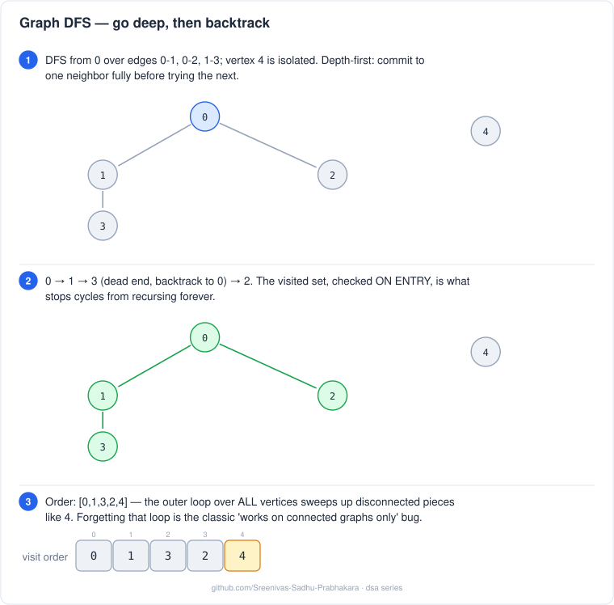

# Graph DFS Traversal

> Striver SDE Sheet 153 · Day 23 Graph — adjacency list, visited array, recursive descent, and an outer loop that catches disconnected components. Go, stdlib only, tested.

## Problem

The depth-first visit order of an undirected graph — the primitive underneath cycle detection, topological sort, SCCs, bipartite checks, and half of Day 23–24.

## Approach

Three parts worth internalizing as a unit. The **adjacency list** (slice of neighbor slices; each undirected edge inserted both ways) is the representation every follow-up assumes. The **visited array** breaks cycles — graphs, unlike trees, offer multiple routes to a node. The **outer loop** over all vertices is the part beginners drop: real graphs are disconnected, and launching DFS from every yet-unvisited vertex is what covers all components (and, incidentally, counts them). Recursion depth equals the longest path, so adversarially deep graphs would want the explicit-stack form.

**Complexity:** O(V+E) time, O(V) space.

## Visual walkthrough

Read the picture top to bottom — each numbered frame is one moment of the algorithm
running on this repo's test example.

## Run

    go test ./...   # verify
    go run .        # demo

---

One of 191 repos solving Striver's SDE Sheet in Go — stdlib only, one problem per repo, every solution tested. Browse the set: [`dsa-*` repos](https://github.com/Sreenivas-Sadhu-Prabhakara?tab=repositories&q=dsa-&type=source).
